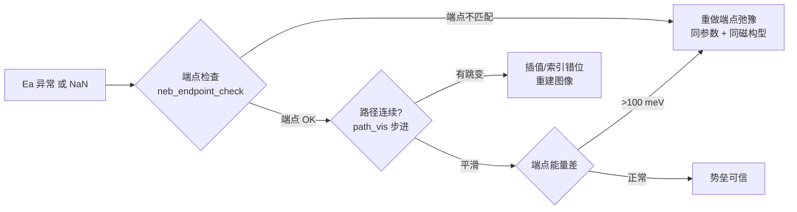

# NEB Toolkit

> CI-NEB 的"事后三件套"：**端点一致性核验 → 迁移路径 3D 可视化 → 势垒曲线**。

NEB 的结果出问题时，九成不是算错了，而是**输入就没准备好**：端点没真正弛豫、端点用了不同参数、插值不连续、跟踪错了原子。这个仓库把这几件事变成可检查的命令。

---

## 三个工具

### 1. `neb_endpoint_check.py` — 端点一致性核验

检查"冻结端点"是否真的等于"端点弛豫后的结构"。

```bash
cd <neb_package>          # 含 00/ 08/ 00_IS/ 08_FS/
python neb_endpoint_check.py --cell 00/POSCAR
```

输出：端点 vs 弛豫前/后的 max|d| 与 RMS（有 pymatgen 时用 `StructureMatcher`），以及**冒烟判据**——如果两个端点与各自"未弛豫结构"的 RMS 差不多大，说明端点大概率是"对称性搬运"而不是真实弛豫结果。

### 2. `path_vis.py` — 迁移路径可视化

把迁移原子的整条路径作为 ghost 原子（默认 Xe）追加进结构文件，直接用 VESTA / OVITO / catgo 打开就是"结构 + 路径"一张图。

```bash
python path_vis.py images/ --npts 20 --ghost Xe --out path.poscar --cif
```

- 自动识别迁移原子（端点位移最大者），并打印位移 Top5
- 逐图像用**最小镜像位移累加**跟踪，跨周期边界不会出现"跳一个晶格矢量"的假位移
- 只取纯数字命名的图像目录（`00/01/...`），自动排除 `00_IS/`、`08_FS/` 这类端点副本
- 按弧长等距重采样，路径点在图像间分布均匀
- 输出 VASP5 POSCAR（可直接给 VASP 读）；`--cif` 另出 CIF（需 pymatgen）

### 3. `plot_barrier.py` — 能量曲线与势垒

```bash
python plot_barrier.py images/ --out barrier                 # 从各图像 OUTCAR 取末次 free energy
python plot_barrier.py --ener path.dat --out barrier --xlabel "Reaction coordinate (Å)"   # VTST 的 .dat/.ener
```

输出终端表格 + CSV + PNG（有 matplotlib 时），并自动检查**端点能量差**：

> 若 `|E_last − E_first| > 100 meV` 会直接告警——这几乎总是"两个端点用了不同参数/不同磁构型弛豫"，此时势垒不可比。

---

## 典型排障流程



---

## 依赖

```bash
pip install numpy matplotlib
pip install pymatgen      # 可选：端点 StructureMatcher 比对、CIF 输出
```

`neb_endpoint_check.py` 与 `path_vis.py` 的核心几何计算只用 numpy，pymatgen 缺失时自动降级。

---

## 许可

MIT
